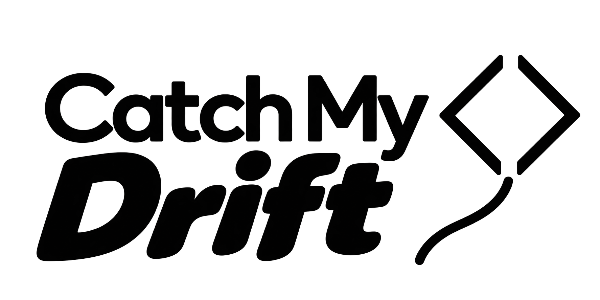

# catchmydrift



`catchmydrift` is a Git-backed command-line check that reminds busy engineers to keep documentation up to date.
It works by making sure each context / documentation file is updated when the code files it supports have drifted.

Out of the box, it validates that the code has not drifted more than 20% since `AGENTS.md`, `README.md`, and other markdown files were last updated.

That percentage, as well as the relationship between files-that-drift and files-that-should-be-updated, can be customized with a small configuration file.

- The command is **deterministic**.
- It is does not change anything.
- It does not try to understand what changed; it simply alerts that change has occurred.
- It prints a brief report and returns a pass / fail exit code.
- It can be used by people, agents, or CI.

## Install and run

catchmydrift requires Node.js 22 or later and a Git repository.

When the package is available from your configured npm registry, install it as
a development dependency:

```sh
npm install --save-dev catchmydrift
```

Then run it from the repository root:

```sh
npx catchmydrift
```

For continuous integration, add a script such as:

```json
{
  "scripts": {
    "check-drift": "catchmydrift --threshold=5"
  }
}
```

```sh
npm run check-drift
```

## Zero-configuration checks

With no `catchmydrift.config.json` in the selected root, catchmydrift:

- watches every Git-tracked file whose name ends in lowercase `.md`;
- relates each watched Markdown file to every Git-tracked file in the same
  directory and its descendants; and
- ignores directories that contain no tracked lowercase Markdown file.

For example, `docs/README.md` is related to all tracked files under `docs/`,
while a root-level `README.md` is related to all tracked files in the
repository. Files ending in `.MD` are not selected by this default mode.

```sh
# Check the current directory (the default)
catchmydrift

# `check` is optional and equivalent
catchmydrift check

# Limit a check to a tracked repository subdirectory
catchmydrift check docs

# Allow up to five percent drift before the check fails
catchmydrift --threshold=5
```

The positional root must be inside a Git repository. Output paths are relative
to that selected root.

## Configuration

Creating `catchmydrift.config.json` in the selected root switches from the
zero-configuration Markdown rules to the configured rules. The configuration
has named groups of related files and one or more watch rules. All globs are
root-relative POSIX globs; dotfiles are matched. `include` is required for a
group and a watch rule; `exclude` is optional.

```json
{
  "$schema": "./node_modules/catchmydrift/catchmydrift.schema.json",
  "threshold": 5,
  "groups": {
    "application": {
      "include": ["src/**", "package.json"],
      "exclude": ["src/generated/**"]
    },
    "agent-guidance": {
      "include": ["AGENTS.md", ".agents/**", "skills/**"]
    }
  },
  "watch": [
    {
      "include": ["README.md", "docs/**/*.md"],
      "groups": ["application"],
      "threshold": 10
    },
    {
      "include": ["AGENTS.md"],
      "groups": ["application", "agent-guidance"]
    }
  ]
}
```

In this example, documentation and `AGENTS.md` are watched explicitly. A
watch rule can select arbitrary Git-tracked file types, not only Markdown.
Groups are unioned when a rule names more than one group, so a related path is
measured once even if several groups match it.

The effective threshold is chosen in this order:

1. `--threshold` on the `check` command
2. The watch rule's `threshold`
3. The configuration's top-level `threshold`
4. `20`

Each watched path may be selected by only one watch rule. A literal watched
path that is no longer tracked is reported as missing; a wildcard or group
that matches no historical tracked path is a configuration error. The
configuration file may itself be a watched or related file when its rule and
group select it.

Use a configuration other than the default with `--config`. Its resolved path
must remain inside the selected root:

```sh
# Current directory is the selected root
catchmydrift --config config/catchmydrift.json

# Here `docs` is the selected root and patterns in its config are relative to docs/
catchmydrift check docs --config docs/catchmydrift.config.json
```

The package includes [catchmydrift.schema.json](catchmydrift.schema.json) for
editor JSON-schema support and validation tooling. The example points to the
schema in a local development-dependency installation; adjust `$schema` if you
copy the schema elsewhere.

## What counts as drift

catchmydrift compares each related text file with the selected baseline and
calculates:

```text
(inserted text lines + deleted text lines) / current related text lines
```

The current denominator includes tracked content in the working tree and
index, so staged and unstaged changes are visible. A result equal to the
threshold is healthy; only a higher percentage fails.

Binary files do not contribute to the line-based calculation in v1. A group
containing only binary content therefore reports no text to measure rather
than treating byte changes as line drift. Reviews require binary and symlink
changes to be committed too, even though binary content does not contribute to
percentage drift.

`.catchmydrift-state.json` is always excluded from watched and related
content, even if a configuration glob would otherwise select it.

## Review a file without editing it

Use `review` after you have assessed a watched file against committed related
content. It records the current `HEAD` commit SHA as that file's review baseline
without editing the watched file:

```sh
# Commit the changes you assessed first
git add docs/service.js
git commit -m "Update service"
catchmydrift review docs/README.md

# Share the review baseline
git add .catchmydrift-state.json
git commit -m "Record documentation review"

# Review an arbitrary configured watched file
catchmydrift review AGENTS.md --config catchmydrift.config.json

# Review paths under a subdirectory root
catchmydrift review README.md --root docs
```

`review` accepts one or more exact, currently watched file paths. Its options
may appear before or after the paths:

```text
catchmydrift review <file...> [--root <root>] [--config <path>]
```

Use `--` before a filename that begins with `-`. `--threshold` belongs only to
`check`, not `review`.

Review requires an existing commit and rejects staged or unstaged changes in
any selected watched file or its related tracked files, including additions,
deletions, binary files, and symlinks. Unrelated dirty files and untracked files
do not block a review. Review validates all targets before writing: an invalid
or dirty target leaves the entire batch unchanged. Paths outside the selected
root, missing or unsafe paths, and files that are not currently watched are
rejected.

On success, the only file it may create or update is
`.catchmydrift-state.json` in the selected root. It does not modify, touch,
stage, or commit watched files or other content. The state is an unversioned
JSON object mapping repository-relative watched paths to full commit SHAs:

```json
{
  "docs/README.md": "89b5d14c84a4a05e7d3e204cb16b587ef647dc19"
}
```

The format is defined by `catchmydrift-state.schema.json`, shipped with the
package. Keys remain relative to the repository even when scanning a
subdirectory. Each SHA must identify a commit reachable from the current
`HEAD`. There is no version field, relationship signature, or file snapshot.
The previous versioned snapshot format is unsupported; remove the old state
file and run `review` again against committed content.

Without a saved review, drift starts at the last commit that changed the
watched file. With a saved review, it starts at the newer of that commit and
the review commit. A later watched-file update therefore supersedes an older
review. Saved reviews work locally immediately and travel to fresh clones when
the state file is committed. Repeating a review at the same `HEAD` produces
identical state.

Subsequent committed, staged, and unstaged related changes contribute ordinary
percentage drift, subject to the threshold. Relationships always come from the
current configuration; changing a relationship keeps the saved SHA as the
baseline and applies the new relationship to it. Review state itself is
excluded from drift. Malformed state, invalid paths, and SHAs that are missing,
are not commits, or are not reachable from `HEAD` make the check unhealthy.

## Commands and exit status

```text
catchmydrift [check] [root] [--threshold <0-100>] [--config <path>]
catchmydrift review <file...> [--root <root>] [--config <path>]
catchmydrift --help
catchmydrift --version
```

`check` is the default command. `review` uses `--root` because it has one or
more file arguments; `check` uses its optional positional root.

| Exit status | Meaning                                                                                             |
| ----------- | --------------------------------------------------------------------------------------------------- |
| `0`         | The check is healthy, or a review was recorded successfully.                                        |
| `1`         | A watched file exceeded its threshold, is missing, or has invalid review state. |
| `2`         | Command usage, root, configuration, or review-target validation failed.                             |

## GitHub Action

Use this repository as a JavaScript Action to run the existing drift checks without installing npm dependencies in your project. It runs on Node 24 supplied by the Actions runner. The committed `dist/` bundle contains catchmydrift and its runtime dependencies. The small Action wrapper uses GitHub environment files directly for outputs and the job summary, so it does not need the Actions toolkit. A full Git history is required to find each watched file's last-change commit and resolve saved review SHAs. Set `fetch-depth: 0` on `actions/checkout`: zero means all history, whereas the default depth of one fetches only a single commit. The Action rejects shallow checkouts with setup instructions rather than calculating drift from an incomplete baseline.

Copy [the example workflow](examples/drift-workflow.yml) to `.github/workflows/drift.yml`, replacing `ACTION_COMMIT_SHA` with the full reviewed commit SHA containing this Action. No Action release tag has been published as part of this change.

```yaml
name: Documentation drift
on: [pull_request, workflow_dispatch]
permissions:
  contents: read
jobs:
  drift:
    runs-on: ubuntu-latest
    timeout-minutes: 5
    steps:
      - uses: actions/checkout@3d3c42e5aac5ba805825da76410c181273ba90b1 # v7.0.1
        with:
          fetch-depth: 0
          persist-credentials: false
      - uses: pmcelhaney/catchmydrift@ACTION_COMMIT_SHA
        id: drift
      - uses: actions/upload-artifact@v4
        if: always() && steps.drift.outputs.report-directory != ''
        with:
          name: catchmydrift-review
          path: ${{ steps.drift.outputs.report-directory }}
          retention-days: 7
```

By default this runs offline, does not fail for drift, and needs only `contents: read`. Set `fail-on-drift: 'true'` to gate a job on the existing deterministic threshold. The Action never commits, stages, updates review state, changes source files, opens a PR, merges, or runs repository scripts. It does not post PR comments and requires no write token. For private repositories, keep the report artifact accessible only to intended reviewers.

### Inputs, outputs, and failures

| Input | Default | Purpose |
| --- | --- | --- |
| `root` | `.` | Scan directory within `GITHUB_WORKSPACE` |
| `config` | auto-discover | Existing JSON configuration path, relative to workspace |
| `threshold` | configuration or 20 | Override drift threshold percentage |
| `fail-on-drift` | `false` | Fail when deterministic drift exceeds threshold |

Outputs: `drift-detected` (`true`/`false`) and `report-directory`. The directory contains `report.json` with `driftDetected` and per-file results: watched path, baseline SHA, drift percentage, threshold, and missing-file status. An infinite drift percentage is represented as `null` in JSON. The job summary shows whether drift was detected.

Invalid inputs, shallow history, unhealthy state/configuration, or failed analysis fail the step. Drift itself fails the step only with `fail-on-drift: 'true'`. The Action does not fetch history automatically; configure checkout before running it.

### Sharing and maintaining the Action

After review and merge, another repository can consume `pmcelhaney/catchmydrift@<full-commit-SHA>` directly; a Marketplace listing is optional. Prefer full SHA pinning for reproducibility and supply-chain review. Maintainers may later publish a release and major-version tag such as `v1`; movable tags are convenient but can change behavior between runs. Publishing a release, moving tags, and accepting Marketplace agreements are separate maintainer actions, not performed by this PR. See [GitHub's JavaScript Action guide](https://docs.github.com/actions/tutorials/creating-a-javascript-action) and [publishing guide](https://docs.github.com/en/actions/sharing-automations/creating-actions/publishing-actions-in-github-marketplace).

For Action changes, run `npm ci`, `npm run build:action`, `npm test`, and `git diff --check`. Commit the regenerated `dist/` files alongside source. CI rebuilds the bundle and checks for differences, then exercises it from a separate consumer directory without `node_modules`. Tests use real temporary Git histories, including shallow and full-history consumer checkouts.
